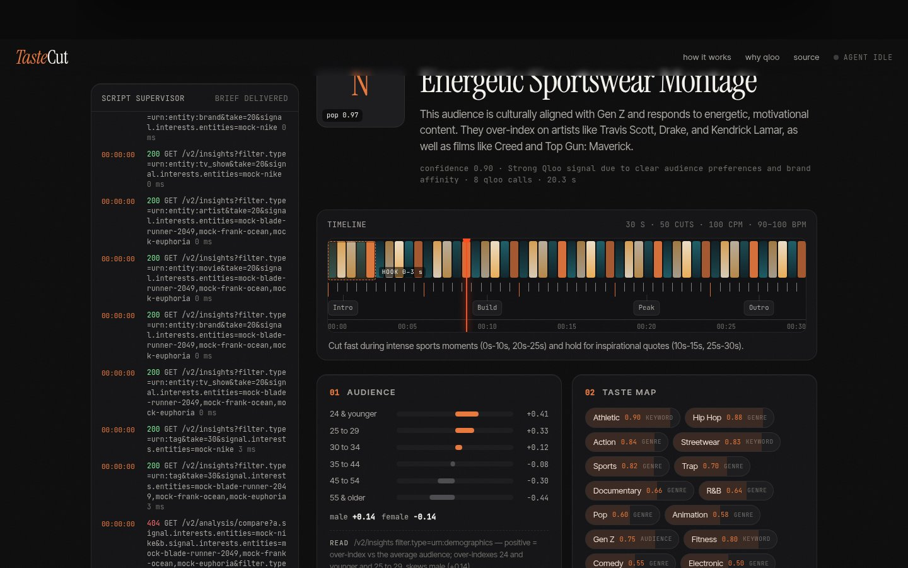

# TasteCut

**A brand walks in. A brief that knows what they love walks out.**

TasteCut is an agent for video editors. Give it a brand (and optionally the deliverable and a couple of notes) and it reads that brand's audience on [Qloo's Taste AI](https://qloo.com) — what those people actually watch, hear and buy, with an affinity score on every name — and cuts it into a working edit brief: cuts per minute, average shot length, edit style, typography pairing, colour grade, music direction with reference artists and BPM, references, do/don't, sound design. Every section names the affinities that drove it. Then it scores *your* reel against the brand's taste, so you know before the call whether you're the right editor for the job.

Live: **https://tastecut-5eo.pages.dev**



Built for the Qloo Agentic Hackathon (October 2026) by Matthew Ifeanyi ([@zxreigns](https://github.com/zxreigns)).

---

## Why

Editors get briefs like "make it feel premium but young". The brand's marketing deck tells you what the brand *wants* to be; it never tells you what the audience already loves. Qloo's taste graph does, with numbers. TasteCut turns those numbers into the five decisions an editor makes in the first hour — pacing, type, grade, music, references — and shows its work.

## What the agent does

```
READ     small model cleans the slate: brand, category guess, 3 proxy brands
RESOLVE  GET /search?types=urn:entity:brand   → the brand entity (or proxies if it's too small for the graph)
GRAPH    7 × GET /v2/insights in parallel, signal.interests.entities = the brand:
           urn:demographics · urn:tag (taste tags) · urn:entity:artist · urn:entity:movie
           urn:entity:tv_show · urn:entity:brand · urn:entity:podcast
DERIVE   no model: genre tags → tempo index → cuts/min & shot length; tags pre-score
           13 colour grades, 14 type pairings, 12 edit styles; artist genres → BPM window
WRITE    two writers in parallel (craft / music+references) return strict JSON,
           each field citing the affinities behind it; a deterministic normaliser
           keeps cuts/min, palette hexes and cue timecodes honest
MATCH    the editor's reel → GET /search per reference → the same four affinity sets
           for the editor's taste → weighted Jaccard vs the brand (75%) + taste-tag
           overlap (25%) → a 0–100 score with the shared entities named
BASELINE the same brief by the model alone, no graph, shown side by side ("Why Qloo")
```

Everything streams to the browser as server-sent events, so the agent's reasoning, every Qloo call (endpoint, status, ms) and the writers' progress are visible while it works — the console is modelled on a script supervisor's log, with timecodes.

### Qloo endpoints used

| Call | Purpose |
|---|---|
| `GET /search?query=&types=urn:entity:brand` | resolve the brand (and each reel reference) to an entity id |
| `GET /v2/insights?filter.type=urn:demographics&signal.interests.entities=` | age / gender over-index of the brand's audience |
| `GET /v2/insights?filter.type=urn:tag&filter.tag.types=…&signal.interests.entities=` | the taste vocabulary (genres, moods, styles) with affinities |
| `GET /v2/insights?filter.type=urn:entity:{artist,movie,tv_show,brand,podcast}&signal.interests.entities=` | cross-domain affinities that become music, references and neighbours |
| `GET /v2/analysis/compare` (best effort) | overlap of the editor's taste set and the brand's |

No legacy `/recs` endpoints. Everything goes through `https://hackathon.api.qloo.com` with the `X-Api-Key` header.

## The brief as a timeline

The brief is rendered the way an editor thinks: a filmstrip of the deliverable with cut marks at the derived cadence (beat-aligned marks in amber), the 0–3 s hook window, the music cue map at its timecodes, and a scrubbing playhead. The type pairing is rendered live on the brand name; the colour grade is applied to a test chart next to the ungraded version; the whole room tints to the grade's accent.

## Stack

- One Cloudflare Pages project: static `site/` + an advanced-mode `worker/_worker.js` (no framework, no build step).
- Models on Workers AI: a small instruct model for the READ step, a 70B instruct model for the two writers and the baseline.
- Briefs are cached at the edge for 24 h per (brand, notes, deliverable) and shareable by URL (`/?b=<id>`).
- Markdown export, print-to-PDF, share link.

## Run it yourself

```
# requirements: a Cloudflare account with Pages + Workers AI, a Qloo hackathon API key
cp scripts/env.example.json scripts/env.json   # add QLOO_API_KEY
bash scripts/deploy.sh                          # direct-upload deploy (see scripts/deploy.py)
```

Environment (Pages project → Settings → Environment variables / bindings):

| Name | Value |
|---|---|
| `QLOO_API_KEY` | your hackathon key (secret) |
| `QLOO_BASE` | `https://hackathon.api.qloo.com` (default) |
| `AI` | Workers AI binding |
| `QLOO_MOCK` | `1` only for local UI work without a key — never in production |

API:

```
POST /api/brief     { brand, notes?, deliverable?: 15s_reel|30s_ad|60s_film|yt_preroll|3min_doc, fresh?: true }   → SSE
POST /api/match     { signal: [entity ids], reel: "Blade Runner 2049, Frank Ocean, Euphoria" }                  → SSE
POST /api/baseline  { brand, deliverable }                                                                         → JSON
GET  /api/share/:id · GET /api/libraries · GET /api/health
```

## Honesty notes

- Cuts per minute, BPM windows, grade and type choices are *derived* from tag affinities by fixed rules in the worker (`TEMPO_TAGS`, `GRADES`, `TYPE_PAIRS`, `EDIT_STYLES`); the writers phrase them and may nudge pacing within a bounded range. The evidence line on each card says what drove it.
- Match scores are set overlap on top-20 affinity lists, not a Qloo-native number; the method is printed under the dial.
- The "Why Qloo" column is the model's unaided guess, kept deliberately so you can see where the graph disagrees with instinct.

## License

MIT — see [LICENSE](LICENSE).
